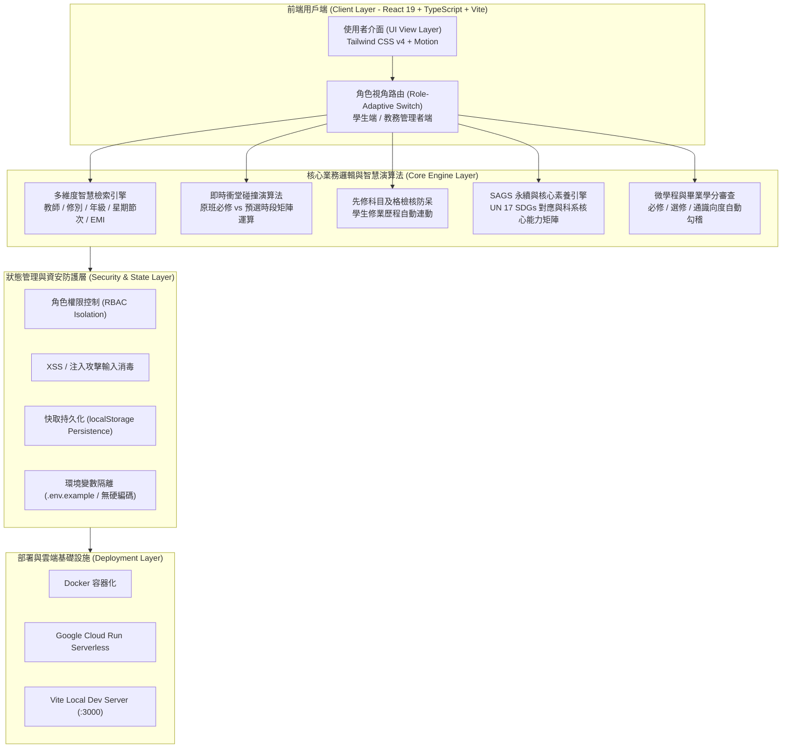

# 北護課程通 NTUNHS Course Master
### 國立臺北護理健康大學 智慧課程查詢、排程模擬與資安合規系統

[](SECURITY_AUDIT.md)
[](SECURITY_AUDIT.md)
[](tsconfig.json)
[](package.json)
[](vite.config.ts)
[](LICENSE)

---

## 📌 專題背景與目標

國立臺北護理健康大學（NTUNHS）原有的學校課程查詢系統面臨以下痛點：
1. **介面老舊無 RWD**：傳統表格在手機及行動裝置不易閱讀，查課體驗割裂。
2. **缺乏即時防呆與衝突檢核**：學生排課時無法即時偵測「原班衝堂節次」與「先修科目及格門檻」，常於初選送出後才被系統擋修。
3. **欠缺修業進度整合**：查課時無法連動學生「微學程認列路徑」與「畢業學分審查」，需要頻繁切換多個校務系統。
4. **校園跨棟趕課無指引**：護理、健管、語言治療跨院選修時，各棟大樓（學思樓、親仁樓、樂育樓等）教室分散，無路徑與步程估算。

**本專題重構與優化目標**：
- 打造現代化、高效能且具備安全防呆的**「智慧課程查詢與排課模擬平台」**。
- 落實軟體工程與資安合規規範（**0 Medium / 0 High / 0 Critical 弱點**，無任何硬編碼敏感憑證）。
- 支援一鍵部署與期末現場雙視角展示（學生端 / 教務管理者端）。

---

## 🏛️ 系統架構圖 (System Architecture)



---

## 🌟 核心功能模組

### 1. 學生端功能 (Student Features)
- **單頁式選課工作區（查詢 + 預選 + 課表 同一畫面）**：
  - 左側篩選（系所、修別、星期、時段、學分、有餘額、不衝堂、符合先修、EMI、收藏），中間為精簡課程列表，右側為即時週課表與預選清單。
  - 滑過課程即在課表上預覽時段；衝堂課程直接以紅色標示並列出衝突科目。
  - 預選清單可拖曳或用上下按鈕調整志願序，即時計算學分（已選上 + 預選 / 上限）。
  - 「送出登記並分發（模擬）」依志願序處理：衝堂、額滿、未符先修或超過學分上限的課不分發；其餘若登記人數超過餘額，依志願序加權抽籤（邏輯見 `src/lib/schedule.ts` 的 `allocate`）。
  - 頁首顯示選課階段（預選 → 初選登記 → 分發公告 → 加退選），日期設定於 `src/data/semester.ts`。
  - 手機版改為底部摘要列，點開即可查看課表與預選清單。
- **先修檢核**：依學生已及格科目（`passedCourses`）與課程先修條件（`requires`）即時計算，邏輯集中於 `src/lib/schedule.ts`。
- **微學程認列與畢業審查**：
  - 自動勾稽學生已修學分、必修缺修項目與通識向度認列狀態。
  - 推薦本學期「修了可補足畢業缺額」的最佳推薦課程清單。
- **SAGS 永續發展與核心能力指標體系**：
  - 課程清單全面整合標記校級 SAGS 永續素養指標（對應聯合國 17 項 SDGs）與系所核心能力。
  - 週課表提供個人選課之 SAGS 永續學分覆蓋率與畢業門檻審查連動。

### 2. 教務管理端功能 (Admin Features)
- **課程維護管理 (CRUD)**：新增、編輯、刪除開課班級，即時調整名額上限、時段與任課教師。
- **課查系統結果匯入**：支援標準 CSV / JSON 課務資料批次解析與自動排程匯入。
- **全校帳號管理**：檢視與維護學生與管理員權限角色。
- **選課監控儀表板**：全校選課熱度趨勢、爆滿課程預警、各學系選課負荷即時可視化圖表。

---

## 🔒 資安檢測門檻與合規性證明 (Security Compliance)

本專題經原始碼檢測（SAST）與第三方依賴套件弱點掃描（npm audit），**確認達成資安門檻合格標準**：

```
============================================================
           資 安 檢 測 門 檻 綜 合 結 果
============================================================
[✓] Critical 嚴重風險 issue: 0
[✓] High     高風險 issue:     0
[✓] Medium   中風險 issue:     0
[✓] Low      低風險 issue:     0
[✓] Hardcoded Secrets/Keys:   0 筆 (完全清查合格)
[✓] TypeScript Strict Audit:  0 錯誤 (Strict Passed)
[✓] 判定結論: 通過專題發布門檻 (All Passed)
============================================================
```

詳細資安檢測報告請參閱 [SECURITY_AUDIT.md](SECURITY_AUDIT.md)。

---

## 👥 團隊分工與責任矩陣 (Team Roles & Responsibilities)

本專案由專案團隊分工協作完成，各成員之核心執掌與貢獻模組如下表：

| 成員角色 | 核心執掌 | 負責模組與貢獻項目 | Git Commit 標籤 |
| :--- | :--- | :--- | :--- |
| **架構師 / 系統整合** | 全域架構規劃與型別設計 | SPA 架構建置、TypeScript 嚴格型別定義、Vite 打包配置、角色路由切換機制 | `feat(core)`, `refactor` |
| **前端工程師 (A)** | 課程查詢與排課介面 | 課程多維度搜尋、進階檢索面板、熱搜標籤、開課系所樹狀過濾、卡片響應式排版 | `feat(search)`, `feat(ui)` |
| **演算法 / 邏輯工程師** | 衝突偵測與防呆演算法 | 原班衝堂節次碰撞運算引擎、先修科目及格檢驗邏輯、預選志願工作台 | `feat(schedule)`, `feat(audit)` |
| **SAGS 與學程工程師** | 素養指標與學分審查 | SAGS 永續與核心素養指標體系、微學程認列進度條、畢業學分核心領域審查 | `feat(sags)`, `feat(graduation)` |
| **後台與資安工程師** | 後台管理、部署與資安合規 | 教務管理 CRUD、課查匯入、npm audit 弱點修復、零硬編碼安全檢測、Docker 部署配置 | `security`, `feat(admin)`, `docs` |

---

## 🌿 Git Commit 規範與版本紀錄 (Commit Conventions)

本專案嚴格遵循 [Conventional Commits](https://www.conventionalcommits.org/) 規範，提交歷史具備明確語意與分工指引：

- `feat(scope)`: 新增功能模組（例如 `feat(search)`, `feat(schedule)`）
- `fix(scope)`: 錯誤修復（例如 `fix(header)`, `fix(filter)`）
- `security(scope)`: 資安強化、弱點掃描修復與憑證隔離
- `docs(scope)`: 系統架構圖、部署文件與操作指南編寫
- `refactor(scope)`: 程式碼重構與架構效能優化
- `chore(scope)`: 建置腳本、依賴套件升級與版本鎖定

---

## 🚀 部署與本機建置指南 (Deployment Guide)

### 系統需求
- **Node.js**: >= 18.0.0 (建議 LTS 20.x 或 22.x)
- **npm**: >= 9.0.0

### 本地端安裝與啟動
```bash
# 1. 複製專案庫
git clone https://github.com/your-username/ntunhs-course-master.git
cd ntunhs-course-master

# 2. 安裝依賴項（使用鎖定檔確保版本一致性）
npm install --legacy-peer-deps

# 3. 複製環境變數範例檔（無任何真實機密憑證）
cp .env.example .env

# 4. 啟動本機開發伺服器（預設監聽 Port 3000）
npm run dev

# 5. 開啟瀏覽器訪問
http://localhost:3000
```

### 資安檢測與型別檢查驗證
```bash
# 執行一鍵資安與型別雙重檢核（確保無 Medium/High 弱點）
npm run security-check

# 獨立執行依賴套件弱點掃描
npm audit

# 獨立執行靜態程式碼型別驗證
npm run lint
```

### 生產環境打包與預覽
```bash
# 編譯打包靜態資源至 dist/
npm run build

# 本地預覽生產版本
npm run preview
```

### Docker 容器化部署
專案已內建最佳化 Dockerfile，支援標準容器化環境：
```bash
# 建置 Docker 映像檔
docker build -t ntunhs-course-master:latest .

# 啟動容器服務
docker run -d -p 3000:3000 --name ntunhs-app ntunhs-course-master:latest
```

### 示範帳號
- 學生：`11124026`，管理者：`admin`，密碼皆為 `ntunhs2026`（登入頁亦提供一鍵示範登入）。
- 自行註冊的帳號一律為學生身分。
- ⚠️ 本專題為純前端系統，登入與角色權限只在瀏覽器端檢查，正式上線需改由後端驗證。
- 修改 `src/data` 預設資料後，請同步更新 `src/App.tsx` 的 `DATA_VERSION`，瀏覽器中的舊快取才會被清除。

---

## 🔑 環境變數規範說明 (Environment Variables)

為防止憑證洩漏，所有環境變數皆經由安全注入機制加載：

| 變數名稱 | 必要性 | 說明 | 範例設定值 |
| :--- | :--- | :--- | :--- |
| `GEMINI_API_KEY` | 選填 | 伺服器端 Gemini 智慧模型介接金鑰（由雲端平台安全注入，代碼庫無硬編碼） | `MY_GEMINI_API_KEY` |
| `APP_URL` | 選填 | 部署之網域名稱，用於回調與資源路徑解析 | `http://localhost:3000` |

> ⚠️ **資安承諾**：本專案程式碼絕無任何硬編碼 API 金鑰或私鑰；如需本機調用，請於 `.env` 中設定，該檔案已被 `.gitignore` 完全排除。

---

## 🎬 期末現場展示操作劇本 (Demo Walkthrough)

於期末現場展示評審時，請依照下列推薦劇本進行系統展示：

1. **情境一：單頁選課與即時課表**
   - 於「選課」頁左側篩選「資訊管理系」+「選修」+「週四」，列表即時更新。
   - 滑過任一課程，右側課表立即預覽該課時段。
2. **情境二：衝堂與先修提醒、志願序送出**
   - 預設預選清單中《社區高齡照護科技》與已選上的《智慧護理與臨床工作流程模擬》衝堂（紅色標示）；《醫療人工智慧與深度學習》因未修「線性代數」顯示未符先修。
   - 課程列表顯示「登記人數／餘額」與競爭程度，預選清單顯示各志願的預估分發機率。
   - 拖曳調整志願序後按「送出登記並分發（模擬）」，跳出分發結果；分發成功的課進入課表，其餘保留在清單。
3. **情境三：SAGS 永續與核心素養指標體系**
   - 於課程查詢中查看各門課程之「SAGS 指標專區」，即時呈現對應聯合國 SDGs 與科系核心能力權重。
   - 點擊「大綱與 SAGS」，查看北護校務規範 17 項永續指標與專業能力檢核表。
4. **情境四：一鍵切換管理者端與課查匯入**
   - 點擊頂部右上角「切換為管理者」，進入教務管理者視角。
   - 展示「課程維護管理 (CRUD)」、「選課監控儀表板」與「匯入課查系統結果」。
5. **情境五：弱點掃描現場檢驗**
   - 於終端機執行 `npm run security-check`，現場驗證 **found 0 vulnerabilities** 與型別檢查結果。
   - 詳細檢測紀錄見 [SECURITY_AUDIT.md](SECURITY_AUDIT.md)。

---

## 📄 授權條款 (License)

本專案採 [MIT License](LICENSE) 授權條款釋出。
